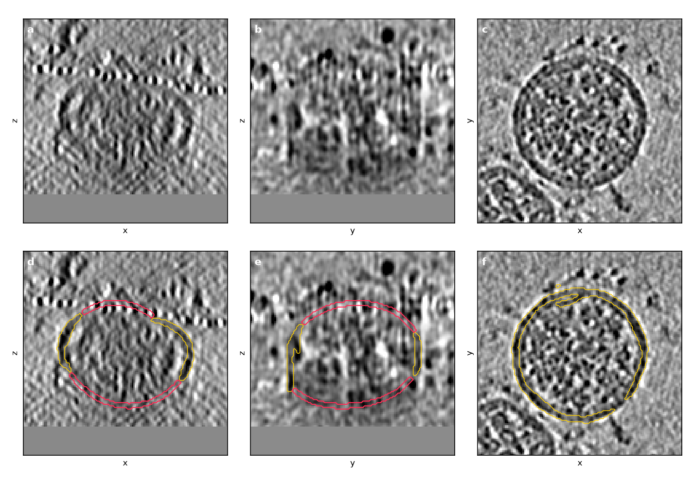
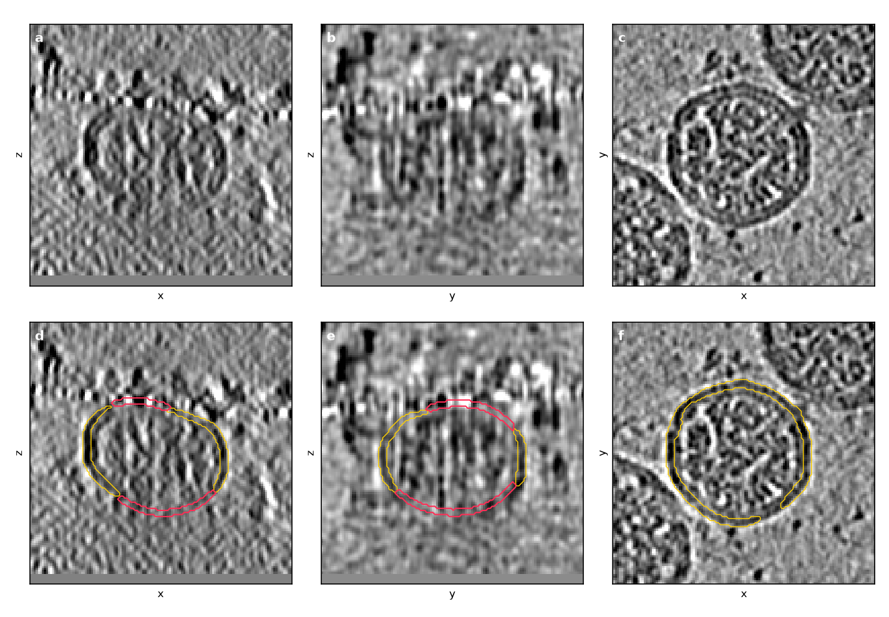
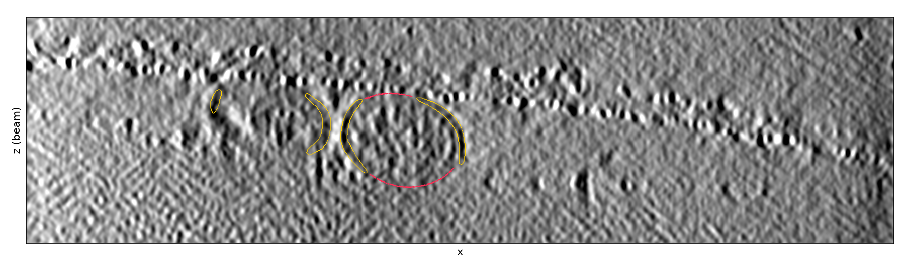
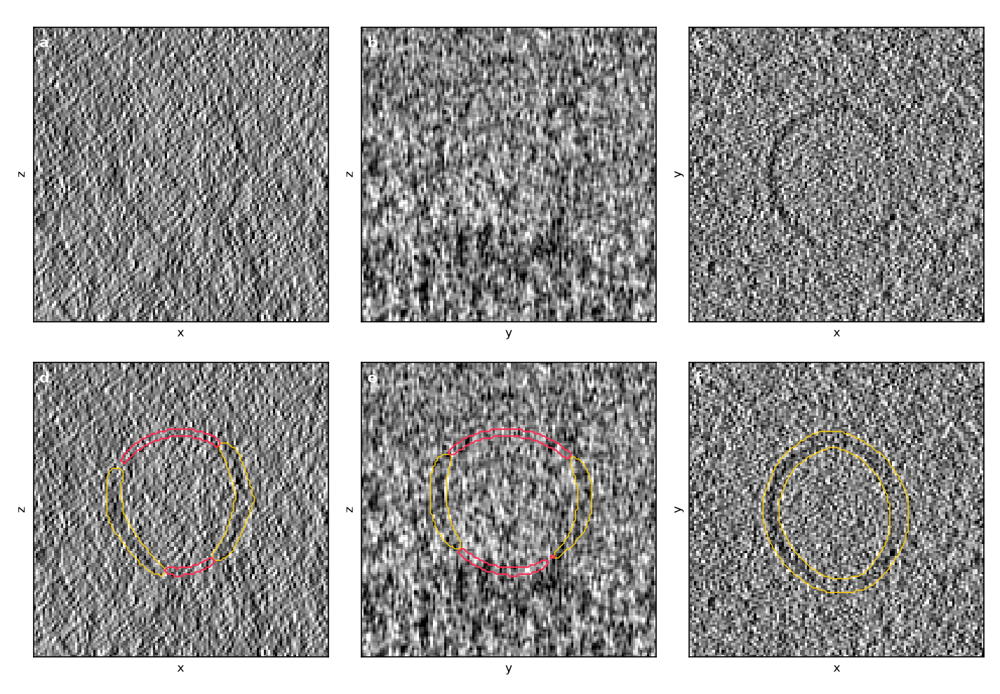
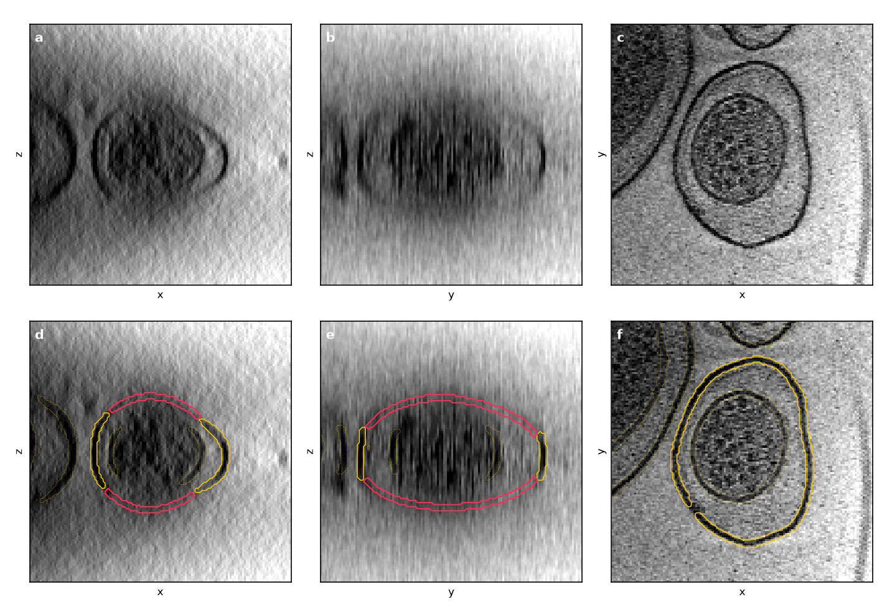
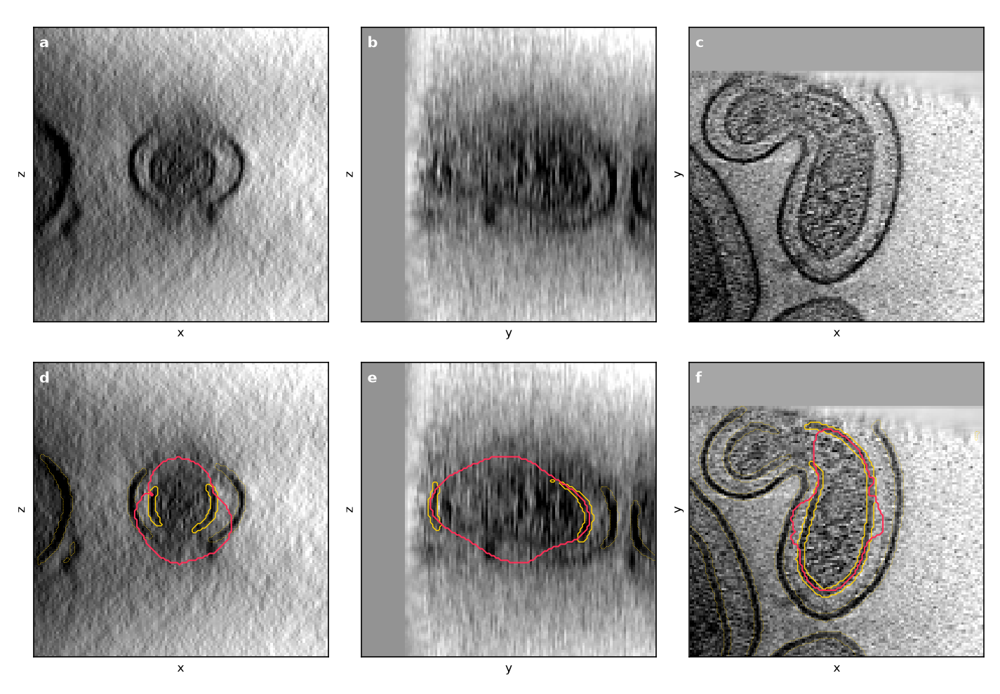
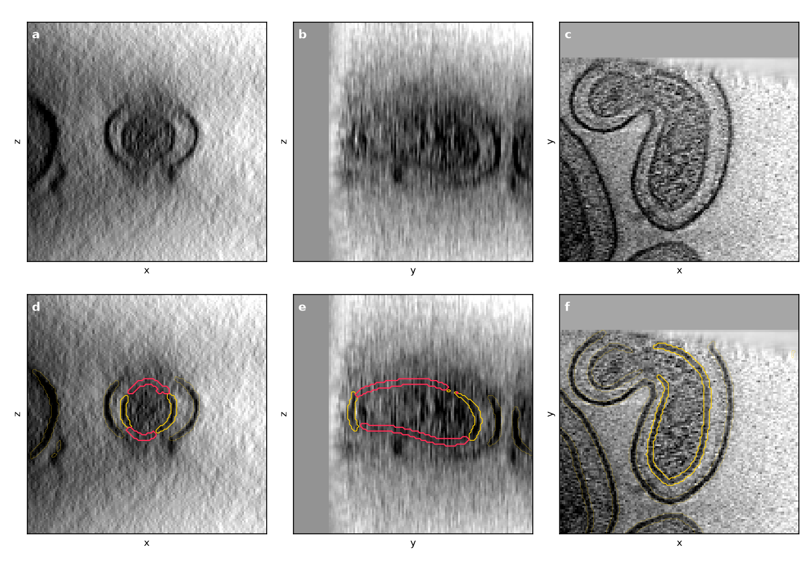

# wedgefill

Complete cryo-ET membrane segmentations where the missing wedge hid them.

In a single-axis tilt series (about ±60°), the missing wedge removes the signal of membrane whose normal is
close to the beam axis. Membrane segmentations such as MemBrain-seg therefore come out as open "( )" arcs in XZ
slices: the tops and bottoms of vesicles and cells are missing. Downstream tools trim these open surfaces
(e.g. surface morphometrics) or fill the missing wedge in the density without a membrane model (IsoNet,
DeepDeWedge). wedgefill completes the **segmentation** itself, and only where the wedge could have hidden
membrane.

## Method

For each membrane object, a closed triangle mesh is fitted to the mask voxels with:

- a robust data term: every mask voxel lies near the surface;
- a **visible-direction constraint**: surface whose normal points more than `hidden_deg` from the beam axis must
  lie on the mask (it is never invented);
- a **Willmore (bending-energy) prior** that shapes the rest.

Only off-mask surface whose normal lies inside the hidden cone is returned as completion. Openings visible in XY
stay open, and concave shapes are not bridged.

```python
import numpy as np
from wedgefill import complete_membrane

points = np.argwhere(mask_of_one_membrane)            # (z, y, x); z = beam axis
res = complete_membrane(points, hidden_deg=55)
res.vertices, res.faces, res.added                    # mesh + faces added as completion
```

`scripts/complete_tomogram.py` runs this on objects of a tomogram + segmentation (Zarr) and saves slice figures.

## Demo on real tomograms

All examples use tomograms and MemBrain-seg membrane predictions as deposited on the
[CZ cryoET Data Portal](https://cryoetdataportal.czscience.com). No retraining or per-dataset tuning was done.

**How to read the figures**
- Top row: raw slices through the object's centre: XZ, YZ (these contain the beam axis, z) and XY.
- Bottom row: the same slices with overlays.
  - **Yellow** = MemBrain-seg mask.
  - **Red** = membrane added by wedgefill.
- In XZ and YZ the mask is an open "( )": the top and bottom are missing. wedgefill adds only those caps. In XY,
  where the wedge hides nothing, nothing is added.

### SARS-CoV-2 virions (portal dataset 10006, 6.1 Å/px)



The top and bottom of the viral envelope are faintly visible in the raw XZ/YZ slices (panels a, b), but MemBrain
misses them. The completion (red, panels d, e) runs along them.



A slab through the whole tomogram. MemBrain arcs are in yellow; added caps on the two accepted objects are in red.



### Vesicle in mouse tissue (portal dataset 10010, 13.4 Å/px)



### Salmonella minicell, outer membrane (portal dataset 10235, 10.2 Å/px)



The completed outer membrane is 171 nm tall. That matches an independent estimate: the inner membrane's completed
height plus the periplasm width seen in XY (about 170–180 nm).

### Why "wedge-aware" matters

A plain closed fit (left) closes the surface in every direction. On this curled membrane it bulges across a
concavity that is clearly visible in XY (panel f), where there is real data. The wedge-aware fit (right) adds only
the top and bottom caps and leaves XY exactly as segmented.

| Plain closed fit | wedgefill (wedge-aware) |
|---|---|
|  |  |

## Cross-validation on real data (rotated wedge)

The real hidden caps hold no data, so we test the completion where the answer is known.
1. Hide a band of membrane that **is** visible: mask voxels whose normal lies within θ of the x- or y-axis.
2. Complete with that band marked hidden, on top of the real beam-axis cone.
3. Measure the distance (nm) from the held-out real membrane to the prediction.

The **floor** is the same distance for the voxels the fit did see, which reflects mask thickness. Script:
`scripts/crossval_rotated_wedge.py`; results in `docs/crossval/`.

Setup: 9 objects (2 SARS-CoV-2 virions, 3 mouse vesicles, 4 Salmonella membranes), 2 axes and 2 band sizes, 36
tests in all. Values are medians over tests (floor ≈ 2.2 nm):

| Held-out band | wedgefill | convex hull | ellipsoid fit | wedgefill best vs ellipsoid / hull |
|---|---|---|---|---|
| θ = 35° | **2.55 nm** | 3.00 nm | 3.09 nm | 15/18, 14/18 |
| θ = 50° | **2.70 nm** | 3.27 nm | 3.36 nm | 12/18, 12/18 |

- **Closed vesicles and virions.** Predictions are within about 0.3 nm of the floor, e.g. SARS-CoV-2 1.4–2.0 nm
  against a floor of 1.2–1.5 nm.
- **Bias.** Median radial bias is −0.1 to −0.2 nm, so there is no systematic inflation across these gaps.
- **Failures.** wedgefill does badly on two non-convex Salmonella objects:
  - a curled, bean-shaped membrane;
  - a membrane with a real XY opening, when the held-out band joins that opening.
  Errors there are 7–22 nm and point inward.
- **Caveat.** The held-out bands are around the equator, so this tests gap bridging by the bending prior, not the
  polar caps specifically.

## Automatic object selection and acceptance

`scripts/complete_tomogram.py --auto N` tries the N largest membrane objects that are not cut by the XY edges of the
tomogram. A result is **accepted** only if it behaves like a closed membrane:
- at least 15% of the fitted surface was added as caps;
- at most 10% of the surface lies in visible directions away from the mask. A high value means the object is not a
  closed membrane, e.g. a streak, an ice edge or a sheet fragment.
- the mask is not flat: its thinnest principal axis is at least 0.2 × its widest.

Rejected objects are still listed in `stats.json` but left off the overview figure.

**Results:** across 5 portal tomograms (10006, 10010, 10156, 10237, 10253), 50 candidates were tried and 5
accepted. All 5 were checked by eye and look plausible. The rejected candidates are mostly MemBrain false positives
(reconstruction streaks, ice and carbon edges) and fragments of cells too large for one crop.

## Limitations

- **Validated only indirectly.** The real hidden caps hold little or no membrane signal, so their shape is the
  prior's prediction. The rotated-wedge cross-validation above tests gap bridging on real membranes, not the poles.
  - Report curvature, height or volume of completed regions with that caveat.
  - Planned validation: dual-axis tomograms, and phantoms with realistic tilt-series simulation.
- **Shape bias.** The Willmore prior favours round shapes, so flattened objects may be completed too tall. A
  Helfrich model with volume or pressure terms is a planned extension.
- **Objects must fit one crop** (128³ after binning by up to 4). For whole cells larger than that, the left and
  right arcs of the same membrane become separate objects and are not joined.
- **Garbage in, garbage out.** Automatic selection relies on MemBrain's mask. Tomograms dominated by
  reconstruction artifacts (e.g. 10156, 10253 above) give no accepted objects, which is the intended outcome.
- In one earlier run a flat streak artifact passed the first two acceptance tests; the flatness test was added
  after that. It has not been tested on a larger artifact set.

## Install and test

```bash
pip install -e ".[scripts,test]"
pytest
```

## Data and tools used in testing

- CZ cryoET Data Portal (Ermel et al., Nature Methods 2024), dataset 10235, run mba2011-08-26-10.
- MemBrain-seg membrane predictions (Lamm et al., MemBrain v2), as deposited on the portal (annotation 101).

## License

MIT
